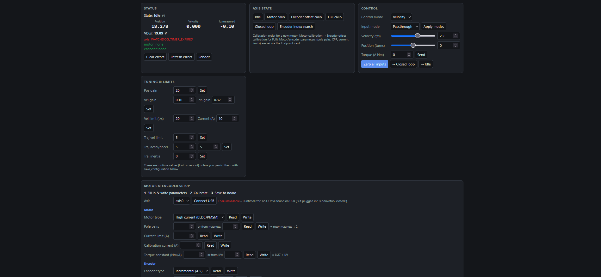

# Geen commando's meer typen: een dashboard voor de motoren

Nu de eerste motor van Baxter draait, wilde ik er makkelijker mee kunnen testen. Tot nu toe ging dat via **odrivetool**: voor elke test opnieuw de juiste commando's intypen om de motor in closed-loop te zetten, een snelheid of positie mee te geven en de status uit te lezen.

Voor één test is dat prima. Maar als je tientallen keren achter elkaar iets wilt proberen, wordt het al snel omslachtig en foutgevoelig. Daarom heb ik een **dashboard** gemaakt waarmee ik de motoren rechtstreeks over **CAN** kan aansturen.

## Waarom over CAN?

In de uiteindelijke architectuur praat de PC via een **USB-CAN-adapter** met alle motorcontrollers van Baxter. Elke motorcontroller krijgt een eigen node-ID op dezelfde bus. Door het dashboard nu al over CAN te laten werken, test ik meteen de route die ik later ook voor de echte besturing ga gebruiken, in plaats van via een USB-kabel per motor.

## Wat kan het dashboard?

Met het dashboard kan ik zonder één regel code te typen:

* **een motor selecteren op node-ID**
* **de motor in idle / closed-loop zetten**
* **een snelheid of positie instellen met een slider of invoerveld**
* **live positie, snelheid en stroom bekijken**
* **foutmeldingen uitlezen en wissen**

Op de achtergrond vertaalt het dashboard elke knop of slider naar het juiste **CAN-bericht** voor de motorcontroller. 

## Het dashboard in actie

> **Afbeelding:** het dashboard tijdens het aansturen van een motor.

## Wat het oplevert

Waar ik eerst voor elke test een reeks commando's moest intypen, kan ik nu met een paar klikken een motor starten, laten draaien en stoppen. Daardoor kan ik veel sneller verschillende instellingen uitproberen en zie ik direct wat de motor doet.

